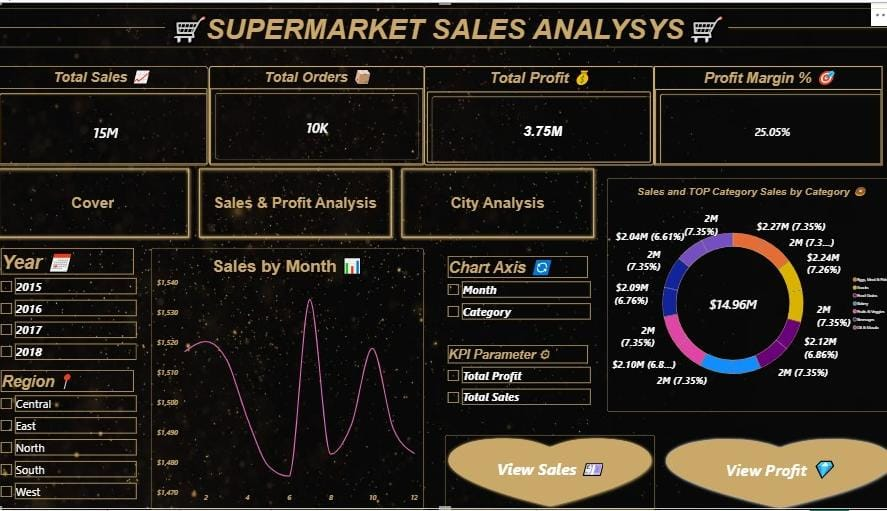

# 🛒 SUPERMARKET SALES ANALYSIS - Profit | Product | Performance

### ✨ Cover Page

---

### 📊 Main Dashboard

**Total Sales: 15M | Orders: 10K | Profit: 3.75M | Margin: 25.05%**

### 📦 Category Analysis

### 🗺️ City & Region Analysis

---

### 📹 Live Links
- 🎬 **[Video Walkthrough - Full Demo](https://drive.google.com/file/d/1rTV66S26rdM7VJD7YRKTTEdnv8kAedP-/view?usp=drivesdk)**
- 📊 **[Full Presentation - PPT](https://docs.google.com/presentation/d/1aZwJjJou_z3RTui3NU3gsdaHnWCg95cu/edit?usp=drivesdk&ouid=108828386598318195394&rtpof=true&sd=true)**

### 🛠️ Tools
SQL Server | Power Query | DAX | Power BI (Black & Gold Theme)

### 💡 Insights
Central & South India are top regions. Eggs, Meat & Fish leads sales. Discount needs calibration for profit growth.

---
**By Nermeen Elsayed Farg - Data Analyst**
